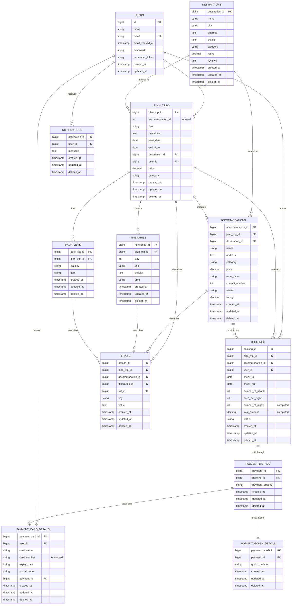

# Tourmates Database - Entity Relationship Diagram

## Key Features:

1. **3NF Compliance**: All transitive dependencies eliminated as of December 3, 2025
2. **Soft Deletes**: All domain tables include `deleted_at` for audit trails
3. **Encryption**: Card numbers are encrypted at application level
4. **Computed Fields**: `number_of_nights` and `total_amount` in bookings are calculated dynamically
5. **Referential Integrity**: Foreign key constraints with CASCADE and SET NULL rules
6. **Flexible Payment System**: Supports both card and GCash payment methods
